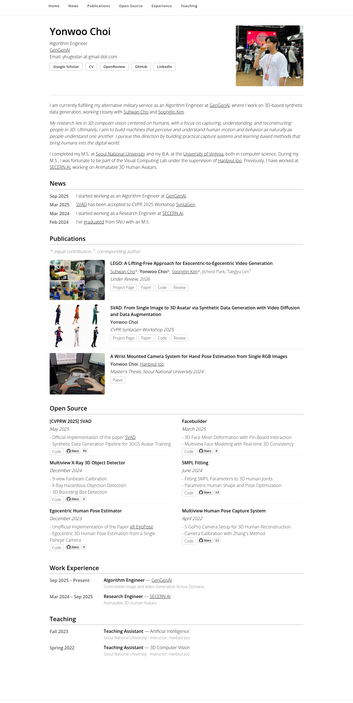

# yc4ny.github.io

Source for my personal homepage: **[yc4ny.github.io](https://yc4ny.github.io)**

The preview above is re-rendered automatically by <a href=".github/workflows/screenshot.yml">GitHub Actions</a> on every push to <code>main</code> and once a week.
